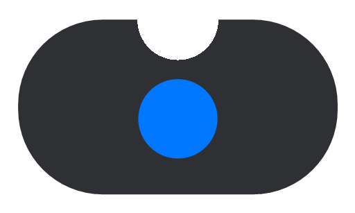

<p align="center"></p>

# Eave

A dynamic island for Windows. A small notch at the top of your screen that shows what
[Claude Code](https://docs.claude.com/en/docs/claude-code) is doing, lets you answer its permission
prompts with one click, and keeps music, downloads, weather and more a glance away.

> Eave is an independent open-source project. It is not affiliated with, endorsed by, or sponsored by
> Anthropic. Claude and Claude Code are trademarks of Anthropic.

## Features

**Claude Code**
- Live status of every running session: project, current tool, elapsed time, tool count, context size
- Allow, Always allow or Deny permission prompts from the island, with a preview of the lines an edit would change
- A sound and notification when Claude finishes or needs you; a warning when a session looks stuck
- Click a session to jump to its terminal

**Widgets**
- Now playing: album art, controls, progress, and a waveform that follows the music
- Downloads in progress (from your Downloads folder) with speed, and a notice when they finish
- Weather, next meeting (from a calendar link), clipboard history, quick-launch apps, timers
- Volume, battery and "app closed" notices; scroll on the island to change volume

**Make it yours (Eave Studio)**
- Notch or floating pill, size, position, opacity
- Themes: Dark, Midnight, Graphite, Clay, Light, or your own colours
- Glow that follows Claude's state, your album art, or a fixed colour, with strength and spread
- Turn every part on or off

## Install

1. Download the latest `Eave-…-win-x64.zip` from [Releases](../../releases) and unzip it.
2. Run `Eave.exe --install` (or just open `Eave.exe` and choose "Eave Studio → Behavior → Install hooks").
   This copies Eave to `%LOCALAPPDATA%\Eave`, starts it with Windows, adds Start menu entries
   ("Eave" and "Eave Studio") and connects Claude Code. A backup of `~/.claude/settings.json` is saved first.
3. Start a new Claude Code session.

Uninstall from Windows Settings → Apps → Eave (this also removes the Claude Code hooks).

## Privacy

Eave runs locally. It listens only on `127.0.0.1:47821` for events from Claude Code on the same PC.
It does not collect analytics or send your data anywhere. It only contacts the internet for features
you turn on yourself:

| Feature | Contacts | What is sent |
|---|---|---|
| Weather (off until you set a city) | open-meteo.com | the city name, then its coordinates |
| Next meeting (off until you add a link) | the calendar link you provide | a normal download of that link |

Clipboard history stays in memory and is never saved; copies marked private by password managers are skipped.
The downloads widget only reads file names and sizes in your Downloads folder.

## Build from source

Requires the .NET 8 SDK.

```
powershell -ExecutionPolicy Bypass -File build.ps1
```

The output is in `dist\`. On PCs with Smart App Control turned on, unsigned builds you make yourself
are blocked from running; use a signed release instead.

## Code signing policy

Free code signing provided by [SignPath.io](https://signpath.io), certificate by [SignPath Foundation](https://signpath.org).

Release builds are produced by GitHub Actions from this repository (`.github/workflows/release.yml`)
and signed through SignPath. Only builds from tagged versions in this repository are signed.

- Committers and reviewers: the members of this repository
- Approvers: the repository owner

### Privacy policy

This program will not transfer any information to other networked systems unless specifically
requested by the user or the person installing or operating it (see [Privacy](#privacy)).

## License

[MIT](LICENSE)
